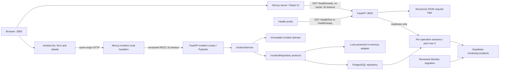
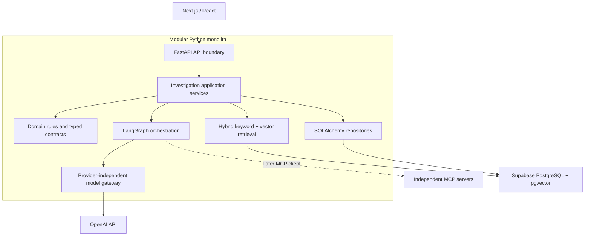
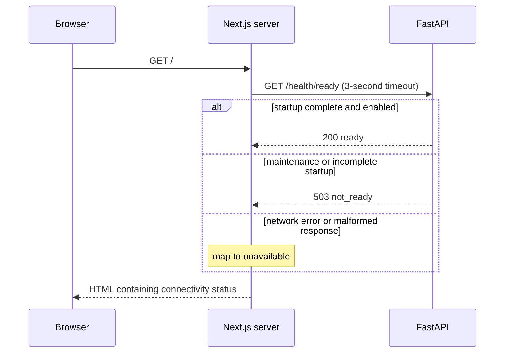

# IncidentIQ architecture

## Implemented foundation

The web server performs the health request at render time. Refresh the page to retry.
The browser never receives BACKEND_URL. Backend downtime renders an explicit unavailable
state without crashing the page. A 503 readiness response has a distinct not-ready state.
Liveness means the HTTP process can answer. Readiness means startup completed and
INCIDENTIQ_READY is true. In PostgreSQL mode it also requires database connectivity and
the mapped incident table; failures return 503. Liveness never queries the database.
Readiness adds a non-secret storage field; existing status/service fields are preserved.
The flag signals maintenance/readiness to probes; it does not gate incident requests.
Both health endpoints send `Cache-Control: no-store`; readiness documents its 503
response in OpenAPI so clients and probes can distinguish temporary unavailability.

## Target architecture including future AI workflows

Domain rules must not import HTTP frameworks, SQLAlchemy, or provider SDKs.
Application services coordinate domain rules and infrastructure adapters. Add those
modules when a real use case needs them; empty layers and generic repository frameworks
would add maintenance without value. Phase 2A implements incident domain, application,
HTTP and PostgreSQL adapter layers. Model inference, retrieval and orchestration remain absent.

Auto mode selects PostgreSQL when DATABASE_URL exists; explicit memory remains per-app
and ephemeral. PostgreSQL incidents survive backend restart/reload. The UI labels the selected mode, validates input,
retains form values on failure and distinguishes loading, empty and error states.
Refresh reloads the list; selecting an incident fetches details. Requests are not cached.
See [API contracts](api.md) and [ADR 0005](adr/0005-incident-domain-and-ephemeral-storage.md).

See [ADR 0006](adr/0006-postgres-persistence-and-reviewed-migrations.md) for persistence,
SSL, pooling, transaction/session lifecycle, sanitized errors and migration safeguards.
Only incidentiq.incidents and public.incidentiq_alembic_version are managed. No unrelated
Supabase objects are migrated. RLS and revoked Data API grants isolate these tables;
the backend still uses the configured owner role pending Phase 2B least-privilege access.
No migrations or create_all run on startup. Schema drift stops the initial migration guard.

Next.js and FastAPI are separate local processes, not independently designed microservices.
Use one backend worker and one frontend dev server on an 8 GB machine. Production
deployment, authentication, authorization, tenancy and telemetry export remain future work.
PostgreSQL credentials stay in ignored api.env and backend memory; the browser never receives them.
Request logs contain method, path, status, and elapsed time; never bodies or query strings.

## Health interaction

