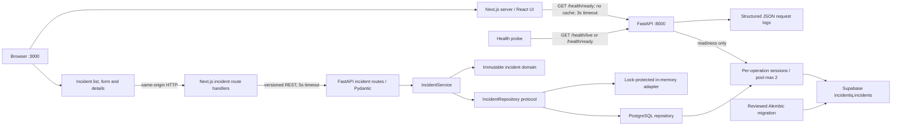
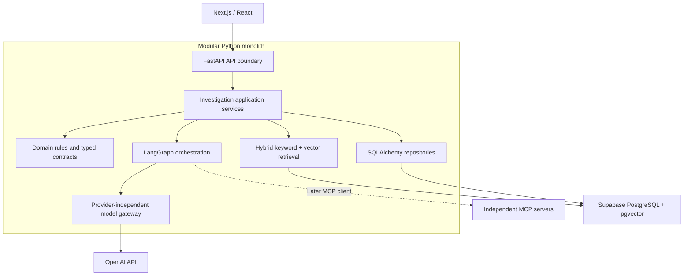
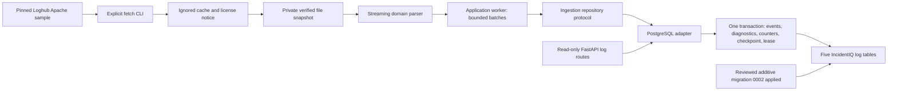
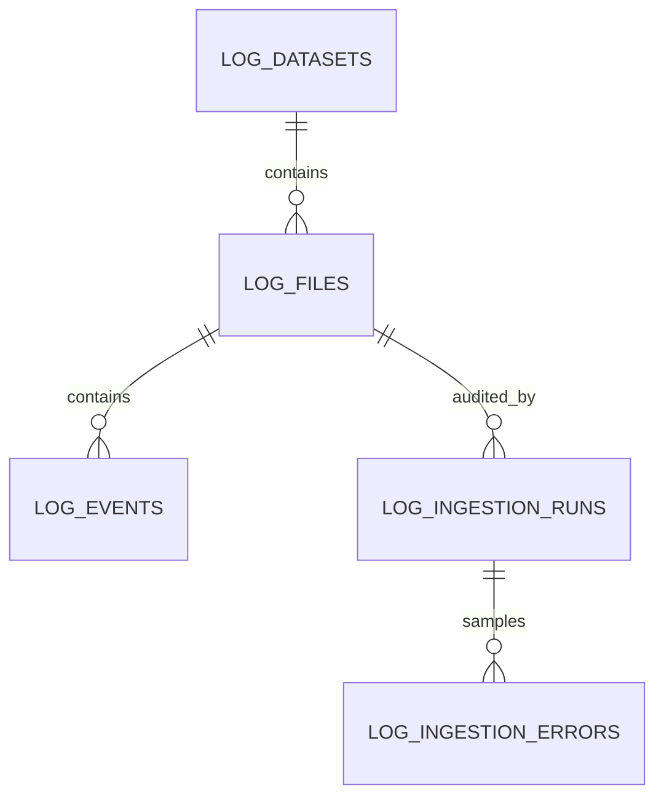
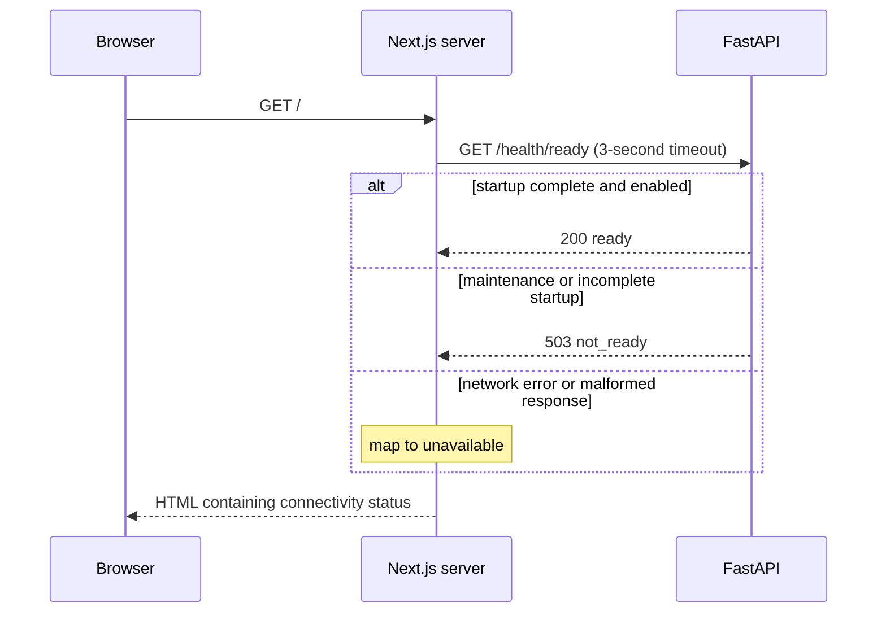

# IncidentIQ architecture

## Current local workspace

The Next.js server authenticates a local bearer credential through FastAPI and stores it
in an HttpOnly cookie. Same-origin proxies forward it server-side. API middleware checks
expiry, revocation and scopes; transaction-local tenant settings plus PostgreSQL RLS filter
incident, log and retrieval access using a restricted runtime role. Operator migration and
ingestion CLIs retain a separate owner connection.

Authenticated workspace routes provide scoped semantic search and per-user LangGraph
investigations. Private SQLite checkpoints and a daily budget ledger remain local.
Reports pause for digest-bound human approval before publication. A separate MCP stdio
process exposes only bounded read tools through the same authenticated API. See
[current controls and evidence](local-completion.md) and [MCP boundaries](phase6-mcp.md).
The foundation diagrams below describe earlier architectural slices.

## Implemented foundation

The web server performs the health request at render time. Refresh the page to retry.
The browser never receives BACKEND_URL. Backend downtime renders an explicit unavailable
state without crashing the page. A 503 readiness response has a distinct not-ready state.
Liveness means the HTTP process can answer. Readiness means startup completed and
INCIDENTIQ_READY is true. In PostgreSQL mode it also requires database connectivity and
the mapped incident table; failures return 503. Liveness never queries the database.
Readiness adds a non-secret storage field; existing status/service fields are preserved.
The flag signals maintenance/readiness to probes; it does not gate incident requests.
Both health endpoints send `Cache-Control: no-store`; readiness documents its 503
response in OpenAPI so clients and probes can distinguish temporary unavailability.

## Target architecture including future AI workflows

Domain rules must not import HTTP frameworks, SQLAlchemy, or provider SDKs.
Application services coordinate domain rules and infrastructure adapters. Add those
modules when a real use case needs them; empty layers and generic repository frameworks
would add maintenance without value. Phase 2A implements incident domain, application,
HTTP and PostgreSQL adapter layers. Phase 3 adds a provider-independent application model
gateway, mock and OpenAI infrastructure adapters, and an explicit local CLI. Inference
is not connected to HTTP routes or the UI. Retrieval and orchestration remain absent.
See [Phase 3 boundaries and budget lifecycle](phase3-model-gateway.md).
Phase 4 now has a file-scoped retrieval service, an ephemeral BM25/cosine/RRF reference
index and a bounded OpenAI embeddings adapter. The PostgreSQL FTS/pgvector adapter and
applied migration 0003 now support all 2,000 persisted event documents. An explicit CLI
provides resumable cached indexing, matching-snapshot replay, status and cited hybrid search.
Retrieval is not wired to HTTP. See [live results and limits](phase4-completion.md).

Auto mode selects PostgreSQL when DATABASE_URL exists; explicit memory remains per-app
and ephemeral. PostgreSQL incidents survive backend restart/reload. The UI labels the selected mode, validates input,
retains form values on failure and distinguishes loading, empty and error states.
Refresh reloads the list; selecting an incident fetches details. Requests are not cached.
See [API contracts](api.md) and [ADR 0005](adr/0005-incident-domain-and-ephemeral-storage.md).

See [ADR 0006](adr/0006-postgres-persistence-and-reviewed-migrations.md) for persistence,
SSL, pooling, transaction/session lifecycle, sanitized errors and migration safeguards.
IncidentIQ manages its own schema and public.incidentiq_alembic_version. No unrelated
Supabase objects are migrated. RLS and revoked Data API grants isolate these tables;
the backend still uses the configured owner role pending the access-control milestone.
No migrations or create_all run on startup. Schema drift stops the revision-aware migration guard.

## Phase 5 investigation execution

The explicit investigation CLI now invokes a LangGraph graph over the existing retrieval
and model ports. It reserves per-run budgets, retrieves up to five file-scoped events,
drafts a bounded JSON report, validates citation identities and interrupts for human
review. Approval is tied to the report/context hash before the only implemented effect:
idempotent private local report publication. It cannot run operational tools or modify incidents.

The standard SQLite checkpointer and a call journal live under ignored per-run cache
directories, with process locks and a 32-run retention boundary. Completed paid nodes
are replayed from the journal; uncertain calls require explicit operator retry with an
additional persistent budget reservation. This local development persistence does not
add Supabase tables, migrations or a checkpoint service. HTTP/UI integration and hosted
multi-user checkpointing are separate work. See [Phase 5 implementation and live validation](phase5-investigations.md).

Next.js and FastAPI are separate local processes, not independently designed microservices.
Use one backend worker and one frontend dev server on an 8 GB machine. Production
deployment, authentication, authorization, tenancy and telemetry export remain future work.
PostgreSQL credentials stay in ignored api.env and backend memory; the browser never receives them.
Request logs contain method, path, status, and elapsed time; never bodies or query strings.

## Phase 2B log ingestion (implemented and live-validated)

The CLI runs synchronously with one worker and a NullPool connection; API sessions keep
their existing pool of two. Together these processes can use three connections. The
parser has no SQLAlchemy/HTTP dependencies; the application service depends on a write
port and a private file snapshot helper. Infrastructure owns network fetching and SQL.
The API has no ingestion write endpoint and does not start a worker.

File SHA256 plus physical line number defines event identity. Equal messages on different
lines remain distinct. Events preserve raw text, original level, source timestamp text
and a naive local timestamp; UTC remains NULL because the source has no zone. The file
pins parser version, source path and commit. No incident linkage is inferred.

Each batch locks its run, checks the owner token and DB-clock lease, inserts with conflict
handling, verifies existing event digests, then commits all counts and its checkpoint
together. A unique partial index permits one running worker globally. Claims additionally
serialize with a transaction advisory lock. Explicit resume replaces expired ownership;
the old token cannot write or mark the resumed run failed. Only classified transient
failures get two retries; a lost acknowledgement causes a checkpoint read before retry.

Stable IDs, provenance, time/level indexes and a literal substring filter provide a future
MCP tool boundary. RAG chunks can later reference event IDs and source lines. Local-time
windows and normalized severity support later anomaly features; this unlabelled dataset
cannot establish anomaly accuracy. Embeddings, FTS, ML and MCP are deliberately absent.
See [ADR 0007](adr/0007-bounded-log-ingestion.md) and the [runbook](phase2b-ingestion.md).

## Health interaction

