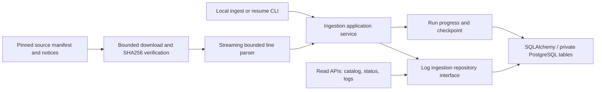

# Proposed Phase 2B: Public log dataset ingestion

Status: Historical proposal. Phase 2B was implemented and live-validated on 2026-10-21;
see [completion and measured evidence](phase2b-live-validation.md). The proposal below
preserves the original planning context; its pending tasks and approval language are historical.
Research checked 2026-10-20 against the current repository and upstream sources.

## Scope and repository findings

Reuse the modular FastAPI backend, typed domain/application/repository boundaries,
SQLAlchemy 2.1.5, psycopg 3.3.6, Alembic 1.20.0 and private incidentiq schema. Keep the
existing two-connection pool, SSL policy, bounded SQL statements, safe errors and tests.
Do not change incident contracts, add infrastructure, or introduce ML dependencies.

The current roadmap calls Phase 2B authentication/access boundaries. This proposal follows
the user's new Phase 2B ingestion scope; approval would move that earlier work to an
explicit subsequent security milestone, without claiming it is complete. The owner-role,
unauthenticated application remains loopback-only. New tables inherit private-schema/RLS
and revoked Data API access, not public upload or search access.

The current migration guard supports only revision 0001 and a pristine database. It must
be extended for an exact, reviewed 0001-to-0002 transition; do not rerun or edit 0001.

## Dataset selection, provenance and terms

Select only Loghub's `Apache/Apache_2k.log`: 2,000 line-oriented Apache HTTP Server error
records. This is the small sample, not the full Apache archive. Loghub's Apache README
identifies collection from a Linux Apache server and points to Anton Chuvakin's Public
Security Log Sharing site. That original site is reachable and describes real-system
samples and permission for public use. The exact originating bundle/host of the sample
is not independently established by that attribution; do not invent that provenance.

Verified references:

- [Apache dataset README](https://github.com/logpai/loghub/blob/master/Apache/README.md)
- [Raw 2,000-line sample](https://github.com/logpai/loghub/blob/master/Apache/Apache_2k.log)
- [Structured reference CSV](https://github.com/logpai/loghub/blob/master/Apache/Apache_2k.log_structured.csv)
- [Original sharing site](https://log-sharing.dreamhosters.com/)
- [Loghub dataset license](https://github.com/logpai/loghub/blob/master/LICENSE)

The applicable Loghub terms are a custom research/academic license, not Apache-2.0.
They require repository attribution, the license notice with dataset copies and paper
citation where applicable. Preserve upstream attribution too. Educational use is the
intended scope; unrestricted commercial licensing is not established by this review.
Keep raw downloads in an ignored cache, accompanied by notices; use synthetic/redacted
examples in the public portfolio. Logs may contain unsanitized IPs, paths and identifiers.

Before implementing acquisition, pin an upstream Git commit and record exact file SHA256,
expected bytes/lines, retrieval date, source path/URL, license notice and parser version in
a small reviewed manifest. These immutable values have not yet been captured. Download
only that pinned raw file; no full-repository clone, archives or arbitrary user URLs.

Format: bracketed English local date/time, bracketed log level, then message. The reference
CSV has LineId/Time/Level/Content/EventId/EventTemplate and 2,000 data records. Its template
labels help validate parsing; they are not anomaly labels. Parse the raw logs as the source
of truth; do not ingest the CSV as additional events. This sample is not a representative,
continuous production timeline or a labelled anomaly benchmark.

Timestamps have a year but no UTC offset. Retain original text and source-local timestamp;
leave UTC event time null and source timezone unknown. Do not silently assume UTC or use
ingestion time as event time. Use explicit English month mapping so Windows locale does
not change parsing. Unknown hosts/components stay unknown; a dataset label is not an
observed service or hostname.

## Architecture

Use an explicit synchronous local CLI for ingest/resume and read-only HTTP endpoints for
catalogue, progress and log queries. No queue, scheduler, background service or FastAPI
BackgroundTasks promise of durable execution. An HTTP trigger can be added later with a
proper execution lifecycle. Existing frontend proxy/incident flows stay intact; a new
ingestion UI is outside this milestone.

Keep parser/domain objects independent of FastAPI/SQLAlchemy. Application services own
validation, progress and transaction boundaries. Infrastructure owns bounded download,
cache and PostgreSQL bulk operations. Add one specialized log repository, not a generic
ETL framework or changes to the incident repository interface.

## Proposed normalized schema

All five tables live in `incidentiq`; UUID keys unless noted. Required timestamps use
TIMESTAMPTZ. FK deletion defaults to RESTRICT; no cascade purge endpoint.

| Table | Main columns and constraints |
|---|---|
| log_datasets | id; unique slug; name/provider; provenance_url; license_name/url/notice; timezone_name nullable; created_at. One catalogue entry, not duplicated per log |
| log_files | id; dataset_id FK; pinned repository_commit/source_path/source_url; content_sha256 BYTEA(32); byte_count; expected_line_count; created_at. UNIQUE(dataset_id, content_sha256); nonnegative sizes |
| log_ingestion_runs | id; file_id FK; parser_version; state; processed/inserted/duplicate/rejected counters; last_committed_line; started_at/finished_at/heartbeat_at; lease expiry and owner token; safe failure code. Counters nonnegative; processed = inserted + duplicate + rejected at every committed checkpoint |
| log_events | id; file_id FK; positive source_line; source_time_text; event_time_local TIMESTAMP WITHOUT TIME ZONE; event_time_utc nullable TIMESTAMPTZ; original_level; normalized_level; message; raw_line; raw_line_sha256 BYTEA(32); ingested_at. UNIQUE(file_id, source_line); bounded text and level CHECKs |
| log_ingestion_errors | run_id FK; source_line; error_code; sanitized explanation; line digest. UNIQUE(run_id, source_line); bounded diagnostic length; no raw line/credentials in error reports |

Version the parser on the run and require the same version when resuming. Events are
immutable for this phase; reject attempts to reinterpret an already ingested artifact
using another parser version. Explicit reprocessing/versioned interpretations are future
work, preventing silent overwrites or ambiguous duplicate representations.

Normalize recognized log levels to a small checked vocabulary while retaining original
level. Do not map Apache error/notice directly onto incident severity or anomaly labels.
Additional source-specific attributes/templates can be added when another parser needs
them; do not duplicate all CSV fields or introduce an unbounded JSON dump now.

Indexes: the unique file/line index supports ordered source pagination; add
(file_id, event_time_local, id) for source-local time windows. Add a partial unique index
allowing only one running ingestion globally. Start with bounded, parameterized literal
substring queries over this 2,000-row corpus; defer GIN/vector indexes until justified.

## Ingestion, validation and idempotency

1. Resolve only an approved catalogue slug. Verify the pinned file in an ignored local
   cache or download with timeouts, byte limit and SHA256 verification. Hash the exact
   bytes before decoding. Checksum mismatch is fatal before event writes.
2. Register/reuse dataset and file metadata by unique constraints. Claim one running run
   atomically; concurrent execution is rejected. CLI records its run ID immediately.
3. Stream strict UTF-8 lines. Strip only line terminators from stored raw content; retain
   physical line numbers. Reject NULs, overlong records, malformed timestamps/levels and
   unparseable envelopes with stable error codes. Do not skip lines silently.
4. Flush at 250 records or 512 KiB of normalized batch data, whichever comes first.
   Configurable record limit is bounded 10–500; maximum source file 2 MiB, maximum record
   16 KiB, initial catalogue fixed to the approved 2,000-line artifact. Oversized lines
   must be drained to the next terminator without unbounded allocations.
5. Use SQLAlchemy Core bulk INSERT ... ON CONFLICT DO NOTHING on (file_id, source_line).
   Confirm a conflicting row has the expected raw digest; differing content is a fatal
   integrity error, not a normal duplicate. Count RETURNING rows rather than relying
   on driver rowcount. Do not deduplicate on timestamp/message alone: repeated real
   log occurrences at different source lines must remain separate events.
6. In one short transaction commit events, sampled validation errors, counters, heartbeat
   and last_committed_line. A failed batch rolls back as a unit. Preserve earlier batches
   and mark fatal failure separately with a fixed error code, never raw driver output.
7. Retry only classified transient failures with at most two bounded backoff retries.
   After uncertain commit acknowledgement, reread the persisted checkpoint first;
   never increment counters twice. Do not retry invalid data or integrity failures.
8. Resume the same run from its committed checkpoint after verifying artifact hash and
   parser version. A persisted lease/owner token fences stale workers: lock/check the
   run row before each batch, and require the same owner for writes/checkpoint updates.
   An expired lease may be claimed by explicit resume; do not depend on session advisory
   locks across transactions, which may be incompatible with transaction poolers.

File replay creates a new audited run but no extra log rows: all valid existing events
count as duplicates. A changed byte sequence is a new artifact, not silently merged.
Duplicates across distinct files are not discarded; they may be legitimate repeated
observations. The first successful file import remains immutable.

States: running, succeeded, partial (finished with rejected records), failed, interrupted.
A crash leaves a persisted running record with an expired lease; status reports it as
interrupted and explicit resume performs the state transition/claim. Heartbeat updates
only accompany useful progress. Store at most the first 100 validation error samples per
run while preserving the full rejected count. Database failures do not become fake row
validation failures. Completed counts must reconcile with the source-line total.

## Proposed APIs

| Endpoint | Purpose |
|---|---|
| GET /api/v1/log-datasets | Approved catalogue and provenance/license metadata |
| GET /api/v1/log-ingestions | Paginated run history/filter by dataset/state |
| GET /api/v1/log-ingestions/{run_id} | State, counts, checkpoint, heartbeat and safe failure |
| GET /api/v1/log-ingestions/{run_id}/errors | Bounded sampled line-level validation errors |
| GET /api/v1/logs | Required file_id; optional level/source-local time bounds/literal q; cursor pagination |
| GET /api/v1/logs/{log_id} | Normalized event, provenance citation and bounded raw source line |

Page size defaults to 50, maximum 100; query text capped at 200 characters. Filters must
validate time basis explicitly because source timezone is unknown. Require a file scope
for searches/time windows; no arbitrary SQL/regex or whole-dataset export endpoint. Omit
raw lines from list responses. Existing health/readiness/incident endpoints are unchanged.

## Resource and cost budget

Supabase currently lists 500 MB database space and 5 GB uncached egress for Free. Data and
indexes consume the database quota, independently of local disk capacity. Sources:
[pricing](https://supabase.com/pricing) and
[database size](https://supabase.com/docs/guides/platform/database-size).

Proposed incremental storage target: under 10 MiB including indexes and bounded audit
records; this is an estimate to measure, not a benchmark result. Preflight the existing DB
usage; refuse ingestion at 400 MB or when conservative projected free headroom is below
50 MB. Do not delete user data or vacuum/reset tables to make an import fit. Compare
pg_total_relation_size before/after and check Supabase usage reporting.

One ingester, no model process, pandas, Spark, task queue or local database. Reuse at most
two SQL connections; ingestion uses one short transaction at a time, leaving capacity
for status/readiness. Cache the tiny verified input, limit repeated downloads, paginate
reads and keep existing SQL timeouts. Proposed incremental worker working-set target is
under 100 MiB over its idle baseline, measured with native Windows process metrics; no
new native monitoring dependency is necessary. Do not run production builds concurrently
with ingestion on an 8 GB machine.

## Implementation tasks and acceptance criteria

| Task | Acceptance criterion | Effort estimate |
|---|---|---|
| Manifest, notices and deterministic fixtures | Commit pin/checksum captured; terms/attribution recorded; synthetic offline fixtures; no arbitrary downloads | 3–4 h |
| Additive schema and revision 0002 | Extend guard for expected 0001; review SQL; preserve incident and unrelated metadata/data; test RLS/grants, FKs, CHECKs and unique indexes | 6–8 h |
| Parser and normalization | Reference sample's 2,000 lines accounted for; timestamps/levels/messages agree with reference CSV; unknown timezone retained; malformed/oversize/encoding tests pass | 4–6 h |
| Bulk ingestion, audit and resume | Replay inserts zero extra events; repeated identical lines at different positions preserved; atomic checkpoints; retries/crash/concurrency/lease tests pass | 8–12 h |
| Read APIs and documentation | Pagination, bounded filters, status/error schemas, safe failures and provenance tested; no incident API regressions | 4–6 h |
| End-to-end validation and resource checks | Live opt-in PostgreSQL tests, interrupted/resumed import, restart persistence, byte/row reconciliation, memory/storage measurements; existing frontend/build suite passes | 5–7 h |

Estimated total: 30–43 engineering hours; allow 32–48 hours (about 4–6 working days) for
review/network/environment contingencies. Additional infrastructure target: $0 within
existing free quotas. No LLM/embedding charges. Labour cost is hours multiplied by the
chosen engineering rate; this is a planning estimate, not a fixed-price quote.

Specific release checks:

- Approved sample imports exactly the expected 2,000 events with reconciled counters;
  unexpected rejects stop acceptance rather than being hidden.
- A full replay keeps the event count unchanged and reports duplicates accurately.
- Crash before/after batch commit and lost acknowledgement resume without gaps, duplicate
  events or counter inflation; concurrent/stale workers cannot advance the same run.
- Invalid encoding, unsupported level/date, empty/malformed/overlong lines and checksum
  mismatch produce bounded diagnostics; failure never exposes SQL, raw credentials or
  unbounded log content. Unknown timezone never becomes invented UTC.
- Opt-in DB tests use isolated transactions/fixtures; migrations are inspected/reviewed,
  incident rows survive unchanged and existing readiness/frontend/API tests still pass.
- Resource targets are measured; no silent free-tier overflow or automatic cleanup.

## Migration and Python 3.15 risks

Never edit 0001 or stamp over differences. Extend both the initial-only guard and its
status validator, which currently expect one table and revision 0001, before applying
0002. The reviewed allowlist must cover only the five new tables/indexes/grants plus the
expected Alembic revision update; fingerprint pre-existing incident/Supabase objects.
Stop for unexpected tables, columns, revision, grants, drift or insufficient headroom.
Review FK/unique index creation and lock timeouts. Do not introduce extensions, partitions,
new enum types, broad autogeneration, destructive downgrade, or automatic startup migration.

Reuse the exact already-tested Python 3.15/SQLAlchemy/psycopg/Alembic combination. Use
standard-library hashing, streaming I/O, regex and deterministic date parsing. Avoid new
native parser/ML packages. Verify actual bulk RETURNING/conflict semantics, bound parameter
count, pooler transactions and timezone roundtrips against PostgreSQL, not SQLite mocks.
Do not expand batches just to use bulk INSERT: observe existing three-second statement
limits and reduce batches if measured latency requires it. No downgrade is planned.

## Future capabilities supported, not implemented

- MCP: read-only, bounded search service methods can become tools with typed filters;
  never accept model-generated SQL. Add identity/tenant scope before external access.
- RAG: stable event IDs, file hashes and source-line provenance provide citations; future
  chunk/embedding tables reference events and record model/version separately. Full-text
  indexing and vector fusion are later migrations. Log content remains untrusted data.
- Anomalies: source-local sequences, level fields, preserved repeats and future versioned
  templates support window/count baselines. Unknown timezone and sampled coverage limit
  cross-system/time-series claims. Apache error levels and template IDs are not anomaly
  ground truth; choose a labelled evaluation corpus later.

No code, dependencies, database schema or data are changed by this proposal. Await approval.
