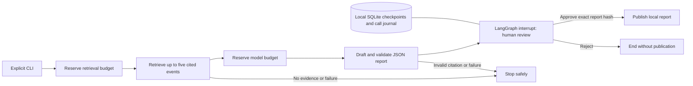

# Phase 5: checkpointed investigation workflow

Completed 2026-11-06 for the native Windows development backend/CLI scope. LangGraph
1.2.20 coordinates retrieval, evidence-bounded report drafting, human review and approved
local report publication. Deterministic mocks, fresh-process resume, failure recovery and
one live OpenAI/PostgreSQL investigation were verified. No operational tool, incident
mutation, public investigation HTTP route or frontend UI is introduced.



## Behavior and approval boundary

The question is bounded to 800 UTF-8 bytes and scoped to the approved pinned log file.
Live retrieval reuses Phase 4's model/dimension-scoped PostgreSQL hybrid search. The graph
accepts at most five distinct events from that file, preserving event/file UUIDs, source
line, path, commit and checksum. Each prompt excerpt is capped at 1,200 bytes without
splitting UTF-8 characters. An empty result ends as `no_evidence` without generating a report.

The model receives untrusted evidence as JSON data, with instructions to distinguish
observations from hypotheses and state uncertainty. Output is limited to 512 tokens and
must match the bounded report schema: summary, findings, uncertainties and next steps.
Every finding must cite IDs from the retrieved evidence. Unknown IDs, unsupported extra
fields (including tool/action fields), malformed JSON and missing uncertainties fail
closed. Citation validation establishes source identity, not the factual truth of a claim;
the report remains a model draft for human assessment.

Human review uses LangGraph `interrupt()` and `Command(resume=...)`, as described in
the official [interrupt guide](https://docs.langchain.com/oss/python/langgraph/interrupts).
Approval requires a real boolean and the exact SHA256 over the run ID, question, source
file, evidence and report. A stale/wrong hash cannot publish. Rejecting ends the run without
publication. Recommendations remain text: neither approval nor any model output can
restart services, execute shell/SQL, call MCP tools, send messages or modify incidents.
The sole implemented effect after approval is writing a private local JSON report.

## Durable execution and cost control

Checkpoints use the standard LangGraph SQLite saver for local development, consistent
with the [persistence documentation](https://docs.langchain.com/oss/python/langgraph/persistence).
Each run has its own ignored `.cache/investigations/<UUID>/` directory containing
`checkpoints.sqlite`, `calls.sqlite`, a lock file, and an approved report only after review.
SQLite setup is local; no Supabase tables or migrations were added for Phase 5.

A process lock serializes operations for each run and releases on process exit. The call
journal records intent before retrieval/drafting and stores successful results before
the graph advances. After a lost graph checkpoint acknowledgement, a completed call can
be reused. A pending journal entry after process loss is treated as uncertain and never
automatically repeated. An operator can explicitly retry a failed run once; successful
retrieval is retained when retrying drafting. Both the previous and new conservative
reservations remain charged. Terminal failure codes suppress provider exception bodies.

The graph persists budget reservations before paid nodes. Default budget is 20,000
micro-USD ($0.02), bounded to $0.001–$0.10 per run. Retrieval reserves query bytes at one
micro-USD each; drafting reserves the gateway's input allowance plus full output limit at
configured conservative rates. These reservations are not refunded in the workflow, even
when actual usage is lower. Review/status never call providers. A retry cannot reset the
remaining budget, and configuration/prompt changes prevent resuming with a different
policy. This is durable per-run accounting, not a shared account-wide or tenant budget.

Local publication is idempotent: an identical approved artifact is reused, a conflicting
artifact is refused. A fault test verifies recovery when the file was written but the
publication acknowledgement was lost. At 32 retained runs, creating another run stops
for retention review instead of deleting history. Raw excerpts/drafts/checkpoints are
private ignored files; the public validation receipt contains only metadata. API keys
are not stored in graph state. Automatic LangSmith tracing is disabled by the CLI.

## Commands

From the repository root, start an offline mock investigation:

```powershell
.\.venv\Scripts\python.exe -m scripts.investigate start --question 'Investigate worker initialization'
```

For a real run, use the existing key, model and conservative input/output rates in ignored
`apps/api/api.env`. The workflow uses reasoning effort `none` and its own persistent CLI
budget; the Phase 3 `INCIDENTIQ_MODEL_BUDGET_MICROUSD` setting is not its budget source.

```powershell
.\.venv\Scripts\python.exe -m scripts.investigate start --provider openai --question 'Investigate worker environment error states' --budget-microusd 20000
.\.venv\Scripts\python.exe -m scripts.investigate status --run-id RUN_UUID
```

Inspect the returned report and source citations. Only after review, approve or reject
that exact report using the printed hash:

```powershell
.\.venv\Scripts\python.exe -m scripts.investigate approve --run-id RUN_UUID --report-sha256 REVIEWED_REPORT_SHA256
# Alternatively:
.\.venv\Scripts\python.exe -m scripts.investigate reject --run-id RUN_UUID --report-sha256 REVIEWED_REPORT_SHA256
```

`resume --run-id RUN_UUID` continues a checkpoint interrupted outside human review, such
as pending approved publication. `retry --run-id RUN_UUID` explicitly retries a terminal
retrieval/drafting failure once. Resuming at a review pause requires approve/reject;
resume does not bypass review. The saved run determines mock/live mode; it cannot be
changed by passing a different provider on a later command.

## Executed verification

- Full offline backend suite: **192 passed**, 6 database tests deselected. The 22 new
  workflow tests cover checkpoint reopening, approval/rejection, stale/coerced decisions,
  invalid citations/tool fields, no-evidence exit, budgets, uncertain call protection,
  explicit retry, locking, publication conflicts and lost-acknowledgement recovery.
- All **6 PostgreSQL regression tests passed** in 37.53 seconds; their invented rows
  rolled back. Final source table/structure hashes, unrelated relation metadata and the
  full 2,000-document vector/content fingerprint remained unchanged. See [integrity receipt](phase5-integrity.json).
- Fresh CLI processes independently started, inspected, approved and rejected synthetic
  runs, without repeating retrieval/drafting. Wrong-hash approval did not publish.
- One live run retrieved and verified five source citations and generated a valid report.
  It reopened unchanged in a new process and remains **awaiting human approval**, with
  no report publication. Of its initial 20,000 micro-USD budget, 16,158 remains after
  conservative reservations. Actual provider billing was not queried. Its checkpoint
  file is 57,344 bytes; total private run files measured 69,633 bytes.
- Ruff lint/format for 72 Python files and pip consistency passed. Backend readiness and
  frontend HTTP returned 200. No frontend source change or production build was needed.

The [sanitized validation receipt](phase5-validation.json) records the live run UUID and
report hash. Review its draft with the `status` command; the live report has deliberately
not been auto-approved by the development validation script.

## Python 3.15 dependency compatibility

LangGraph 1.2.20 and SQLite saver 3.1.3 are pinned; all transitive versions are captured in
the updated requirements lock. Binary-only resolution initially failed for PyYAML and
zstandard on Windows/Python 3.15. PyYAML 6.0.3 was built as a pure-Python wheel; zstandard
0.25.0 was built with the existing Visual Studio 2022 C++ tools after explicitly loading
their developer environment. Python 3.15 was retained; no compiler was installed and
no package dependency was faked or bypassed. Compression round-trip and YAML parsing
checks passed, followed by the full regression suites.

The narrow source-build exception is reproducible with:

```powershell
.\.venv\Scripts\python.exe scripts/build_phase5_wheels.py
.\.venv\Scripts\python.exe -m pip install --only-binary=:all: --find-links .cache/phase5-wheels -r apps/api/requirements-dev.lock.txt
.\.venv\Scripts\python.exe -m pip install --no-deps -e apps/api
```

Fresh Windows setup requires Visual Studio C++ build tools for this exception. All other
dependencies still require wheels. CI now builds these two compatibility wheels before
installing the lock. The builds, wheel reuse and local runtime tests were executed here;
a new clean GitHub Actions run has not been claimed. Wheel files remain ignored build
artifacts, not vendored binaries. LangSmith and sqlite-vec are transitive dependencies;
cloud tracing and SQLite vector indexing are not used by this implementation.

## Scope limits

This is a local, single-operator, question-based investigation workflow over the existing
corpus. SQLite checkpoints are not encrypted or a production multi-tenant persistence
layer. Authentication, incident/report association, hosted checkpoint persistence, wider
semantic report evaluation, UI integration, account-wide spending controls and operational
tool execution remain separate milestones. Local checkpoints should be treated as
trusted application data, not uploaded/imported from untrusted sources.
